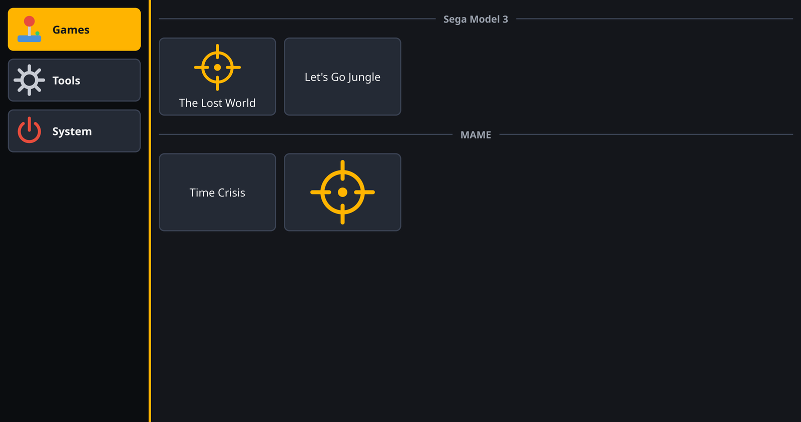

<div align="center">

# 🎯 A.R.M.O.R.Y.

### Arcade Runner Menu On Rails, Yeah!

**A launcher for light gun arcade setups: big tabs and extra-large buttons you can hit with your gun, all configured in a single YAML file.**

[](https://github.com/tbreckle/armory/actions/workflows/ci.yml)
[](https://github.com/tbreckle/armory/releases)
[](LICENSE)


[**Download**](https://github.com/tbreckle/armory/releases) ·
[Features](#-what-is-this) ·
[Configuration](docs/CONFIGURATION.md) ·
[Building](#-building-from-source) ·
[Contributing](#-contributing)

</div>

---

## 🕹️ What is this?

A.R.M.O.R.Y. is a starter hub for arcade light gun setups. Put down the keyboard and mouse, pick up the gun, and shoot the game or tool you want to start.

<div align="center">

</div>

- **Made for light guns**: big tabs in a column on the left, extra-large buttons, and page up/down buttons instead of scrollbars
- **Starts anything**: executables, scripts (`.sh`, `.bat`, `.cmd`, `.ps1`, ...) and files opened through their file association (such as `.ahk` for AutoHotkey)
- **Buttons** with an image, a label or both; **dividers** with an optional label; plain **text labels**
- **Status labels** show whether a background tool runs (`on`, `off` or `fault`, checked every second), with your own texts via `{STATUS}`
- **Gets out of the way**: optionally minimizes while a game runs and comes back when it ends
- **One YAML file** configures it all; mistakes are shown with the exact line
- **A single self-contained binary** for Linux, Windows and macOS. It starts at full display size as a normal window, not in fullscreen

## 🚀 Quick start

Grab the latest release from the [Releases page](https://github.com/tbreckle/armory/releases):

| File | Platform |
|---|---|
| `armory-X.Y.Z-linux-x86_64.tar.gz` | Linux |
| `armory-X.Y.Z-windows-x86_64.zip` | Windows |
| `armory-X.Y.Z-macos-universal.tar.gz` | macOS (Apple Silicon + Intel) |

Unpack it, then copy `examples/armory.yaml` to `armory.yaml` next to the executable (or into your config directory) and adapt it. Every setting is described in [**docs/CONFIGURATION.md**](docs/CONFIGURATION.md).

```yaml
tabs:
  - name: "Games"
    items:
      - divider: "Sega Model 3"
      - button:
          label: "The Lost World"
          image: images/lostworld.png
          run: C:/Emulators/Supermodel/Supermodel.exe
          args: ["roms/lostwsga.zip", "-fullscreen"]
          on_launch: minimize
      - label:
          text: "Sinden driver: {STATUS}"
          monitor: SindenLightgun.exe
```

```bash
armory                          # armory.yaml next to the executable or in the config directory
armory --config my-cabinet.yaml # or an explicit file
```

> [!TIP]
> Builds labeled `0.0.0+<commit>` are unofficial development builds.

## 🔧 Building from source

**Requirements:** Rust 1.98 (pinned in `rust-toolchain.toml`, installed automatically by rustup). On Linux also `libfontconfig-dev` and `pkg-config`.

```bash
cargo run --release -- --config examples/armory.yaml   # build and launch with the example
cargo test              # unit tests
cargo clippy            # lint (warnings fail CI)
cargo fmt --check       # formatting check
```

<details>
<summary><b>🗂️ Repository layout</b></summary>

```
armory/
├── src/                   # Application source (single crate)
├── ui/app.slint           # User interface (Slint)
├── build.rs               # Compiles the UI, injects the build version (ARMORY_VERSION)
├── examples/              # Example configuration with images
├── docs/                  # Configuration reference
├── scripts/               # version.sh, changelog.sh, test.sh
└── .github/workflows/     # CI, release-start, release-finish
```

</details>

## 🤝 Contributing

Contributions are welcome! The project uses **GitFlow**: branch `feature/*` off `develop` and open a PR back to `develop`. CI builds and tests on Linux, Windows and macOS on every push.

- 📖 [GITFLOW.md](GITFLOW.md): branching, versioning and releases
- ⚙️ [.github/WORKFLOWS.md](.github/WORKFLOWS.md): the CI/CD pipelines
- ✅ [.github/DEVELOPMENT_CHECKLIST.md](.github/DEVELOPMENT_CHECKLIST.md): before you open a PR
- 📝 [CHANGELOG.md](CHANGELOG.md): add your change under `## [Unreleased]`

## 📜 License

A.R.M.O.R.Y. is released under the [MIT License](LICENSE).

### Made with Slint

<a href="https://slint.dev">
  <picture>
    <source media="(prefers-color-scheme: dark)" srcset="https://slint.dev/logo/MadeWithSlint-logo-dark.svg">
    
  </picture>
</a>

The user interface is built with [Slint](https://slint.dev), used under the [Slint Royalty-free Desktop, Mobile, and Web Applications License 2.0](https://github.com/slint-ui/slint/blob/master/LICENSES/LicenseRef-Slint-Royalty-free-2.0.md), which requires this attribution. Keep it.

---

<div align="center">

**🪙 INSERT COIN TO CONTINUE 🪙**

<sub>Made with 🔥 for light gun fans.</sub>

</div>

---

## ⚖️ Legal Disclaimer

**USE AT YOUR OWN RISK**

This software is provided "AS IS" without warranty of any kind, express or implied, including but not limited to the warranties of merchantability, fitness for a particular purpose, and non-infringement.

- The developers and contributors of this project assume **no liability** for any damages, losses, or issues arising from the use, misuse, or inability to use this software
- By using this software, you acknowledge that you do so at your own risk
- This project is an independent effort and is not affiliated with or endorsed by any game, emulator or hardware manufacturer unless explicitly stated
